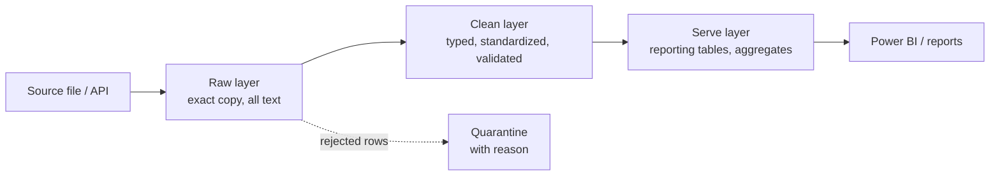

# Module 17: Designing a real ETL pipeline

**Time:** 10–12 hours · **Prerequisite:** Modules 07, 11, 13, 16

## Bakit ko 'to kailangan?

Everything so far was a skill. This module is the job. You'll combine extraction, cleaning, validation, quarantine and idempotent loading into one pipeline that can run every night without you watching it, and that tells you exactly what it did.

**At work and in interviews:** you'll be able to explain, in plain words, *how* data gets from a source system into a reporting table, what can go wrong, and how each failure is handled. That explanation is the core of a junior DE interview. Your BA experience makes it stronger: you can tie every design decision to a business requirement.

---

## 1. ETL vs ELT

| | ETL | ELT |
|---|---|---|
| Order | Extract → Transform (in Python) → Load | Extract → Load raw → Transform (in SQL, inside the warehouse) |
| Typical tools | Python, pandas, Spark | Fivetran/Airbyte + dbt + Snowflake/BigQuery |
| When | Messy files, complex parsing, smaller volumes | Cloud warehouses with cheap compute |

Modern teams mostly do ELT, but the extraction and messy-file parts are still Python. You'll do ETL here and ELT with dbt later in your roadmap. The principles below apply to both.

---

## 2. Layers: raw → clean → serve



Also called **bronze / silver / gold** (the "medallion architecture").

- **Raw:** keep an untouched copy. If your cleaning logic has a bug, you can re-process from raw without asking the source to resend. Read raw files as text (`dtype=str`) so nothing is "helpfully" converted.
- **Clean:** correct types, standard values, duplicates removed, validated.
- **Serve:** shaped for consumers (daily revenue by outlet, guest summaries).

---

## 3. The non-negotiable properties of a good pipeline

### Idempotent
Running it twice for the same input gives the same result. Use upserts or delete-then-insert per date (Module 16).

### Observable
Every run produces a summary: rows extracted, duplicates removed, rejected (by reason), loaded, status, duration. Log it. Store it.

### The reconciliation equation
```
extracted = duplicates_removed + rejected + loaded (+ skipped)
```
If those numbers don't add up, rows vanished somewhere. Test this equation in your pipeline tests. Saying this in an interview signals real-world experience.

### Fails loudly, quarantines quietly
- **Row-level problems** (one bad amount) → quarantine the row, keep going.
- **Dataset-level problems** (duplicate primary keys, zero rows, schema changed) → stop and alert. Loading would corrupt the target.

### Incremental
Don't reload 3 years of history every night. Keep a **watermark** (e.g. the latest `charge_date` already loaded) and only process newer rows. Keep the ability to do a **full refresh** or **backfill** a specific date range when something needs fixing.

### Configurable
Paths, database URLs and dates come from config or arguments, not hardcoded (Module 08).

---

## 4. Designing the pipeline as functions

```python
def run_pipeline(raw_path, guests_path, db_path, rejected_path):
    raw = extract(raw_path)                                  # E: everything as text
    deduped, n_dupes = remove_exact_duplicates(raw)
    clean, rejected = transform(deduped, valid_guest_ids)    # T: types, standards, quarantine
    errors = validate(clean)                                 # dataset-level checks
    if errors:
        return {..., "status": "failed", "errors": errors}   # stop: don't corrupt the target
    loaded = load(clean, conn)                               # L: idempotent upsert
    rejected.to_csv(rejected_path, index=False)
    return {"extracted": len(raw), "duplicates_removed": n_dupes,
            "rejected": len(rejected), "loaded": loaded, "status": "success", "errors": []}
```

Each step is a small, testable function. `run_pipeline` only orchestrates. That shape is what Airflow will schedule in Module 18.

### Transform returns two outputs

```python
def transform(raw, valid_guest_ids):
    df = raw.copy()
    df["amount_num"] = pd.to_numeric(df["amount"], errors="coerce")
    df["date_parsed"] = parse_mixed_dates(df["charge_date"])

    reason = pd.Series(pd.NA, index=df.index, dtype="object")
    reason = reason.mask(reason.isna() & df["amount_num"].isna(), "invalid amount")
    reason = reason.mask(reason.isna() & df["date_parsed"].isna(), "invalid date")
    reason = reason.mask(reason.isna() & ~df["guest_id"].isin(valid_guest_ids), "unknown guest_id")

    rejected = raw[reason.notna()].assign(reason=reason[reason.notna()])
    clean = ...build the typed columns from df[reason.isna()]...
    return clean, rejected
```

The first failing reason wins, so every rejected row has exactly one clear reason.

---

## 5. How to explain your pipeline (interview script)

> "The source is a daily CSV of onboard charges from the POS. I land it raw as text, remove exact duplicates (double-posted rows), then standardize outlet names with a mapping table, parse three date formats explicitly, and convert amounts. Rows that can't be fixed, like blank amounts or guests not in the guest master, go to a quarantine file with a reason, so nothing is dropped silently. Then I run dataset checks: unique charge IDs, sales positive, refunds negative. If any fail, the load stops. Otherwise I upsert into the charges table on charge_id, so re-runs are idempotent. Every run logs a summary, and extracted always equals duplicates plus rejected plus loaded."

Practice saying that out loud until it's natural. Then replace the details with your capstone's.

---

## Exercises (`exercises.py`)

1. `extract(path)` – raw as text
2. `remove_exact_duplicates(raw)`
3. `transform(raw, valid_guest_ids)` – clean + rejected with reasons
4. `validate(clean)` – dataset-level checks
5. `load(clean, conn)` – idempotent upsert
6. `get_watermark(conn)`
7. `incremental_filter(clean, watermark)`
8. `run_pipeline(...)` – orchestration + run summary + reconciliation

## Mini project: run it for real

Write `run.py` with argparse (`--raw`, `--guests`, `--db`, `--rejected`, `--incremental`), logging (Module 07), and your `run_pipeline`. Run it on `data/onboard_charges_raw.csv` twice. Open the database in DB Browser. Read `rejected.csv`. Could you explain every rejected row to a source-system owner?

## Self-check

1. Why keep a raw copy instead of only the cleaned data?
2. Which problems quarantine a row, and which stop the whole load?
3. What's a watermark?
4. State the reconciliation equation.

<details><summary>Answers</summary>

1. So you can re-process after fixing a bug in your cleaning logic, without asking the source to resend, and to audit what was actually received.
2. Row-level issues (bad amount, unknown guest) quarantine the row; dataset-level issues (duplicate primary keys, zero rows, schema change) stop the load.
3. A stored marker of how far data has been loaded (e.g. the latest charge_date), so the next run only processes newer data.
4. extracted = duplicates_removed + rejected + loaded (+ any rows skipped by an incremental filter).
</details>
