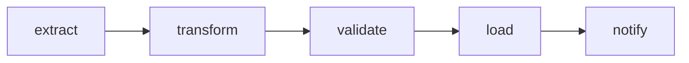

# Module 18: Automation – scheduling, Docker, Airflow and CI

**Time:** 10–12 hours · **Prerequisite:** Module 17

## Bakit ko 'to kailangan?

A pipeline you have to run by hand isn't a pipeline yet. Data engineering means the job runs **on a schedule**, **in a reproducible environment**, **retries** when something temporary fails, can **backfill** past dates, and **tells someone** when it breaks. Docker and Airflow appear in a large share of DE job posts, and both are covered in the DE Zoomcamp, so this module gives you a head start for January.

**At work:** cut-off times, end-of-day jobs, "the interface runs every 15 minutes", "re-send yesterday's file" are all scheduling and backfill requirements. You'll understand how they're implemented and what can go wrong between environments ("it works on my machine" is exactly what Docker fixes).

---

## 1. Scheduling options, from simple to serious

| Tool | Good for | Notes |
|---|---|---|
| **cron** (Linux/Mac) | one script, one server | `crontab -e` |
| **Windows Task Scheduler** | your laptop | GUI; run `python run.py` daily |
| **GitHub Actions (schedule)** | free cloud runs for small jobs | great for portfolio projects |
| **Airflow / Kestra / Dagster / Prefect** | many dependent tasks, retries, backfills, monitoring | what companies use |

### Cron syntax

```
┌ minute (0-59)
│ ┌ hour (0-23)
│ │ ┌ day of month (1-31)
│ │ │ ┌ month (1-12)
│ │ │ │ ┌ day of week (0-6, Sunday = 0)
│ │ │ │ │
30 2 * * *     python /app/run.py      # every day at 02:30
*/15 * * * *   ...                     # every 15 minutes
0 6 * * 1      ...                     # Mondays at 06:00
```

Check expressions at <https://crontab.guru>. Remember: servers usually run in **UTC**. 02:30 UTC is 10:30 in Manila.

---

## 2. Retries with exponential backoff

When a database or API is temporarily down, retry with growing waits: 1s, 2s, 4s, 8s... capped at a maximum. Hammering a struggling server every second makes things worse. Airflow does this with `retries` and `retry_exponential_backoff=True`. You'll compute the delays yourself in the exercises.

---

## 3. Backfills

"The source sent bad data for Oct 3–5; re-run those days." A **backfill** runs the pipeline once per past date. It's only safe if each run is **idempotent** and **parameterized by date**:

```bash
python run.py --date 2026-10-03
python run.py --date 2026-10-04
python run.py --date 2026-10-05
```

Design every pipeline to accept a run date. Never use `date.today()` deep inside your logic; pass the date in.

---

## 4. Docker

**The problem:** your pipeline needs Python 3.12, pandas 2.x, specific system libraries. The server has Python 3.9. Your teammate's laptop has something else.

**The solution:** package the code *and* its environment into an **image**. Run it anywhere as a **container**.

| Term | Meaning |
|---|---|
| **Dockerfile** | the recipe |
| **Image** | the built package (read-only) |
| **Container** | a running instance of an image |
| **Layer** | each Dockerfile step is cached; unchanged steps aren't rebuilt |
| **Volume** | a folder shared between your machine and the container (data that must survive) |

### A Dockerfile for a Python pipeline

```dockerfile
FROM python:3.12-slim

WORKDIR /app

# Copy requirements FIRST so the slow pip install layer is cached
# and only re-runs when requirements.txt changes
COPY requirements.txt .
RUN pip install --no-cache-dir -r requirements.txt

# Then copy the code (changes often)
COPY . .

CMD ["python", "run.py", "--raw", "data/onboard_charges_raw.csv"]
```

```bash
docker build -t onboard-pipeline .
docker run --rm -v "$(pwd)/output:/app/output" -e DB_URL=sqlite:///output/onboard.db onboard-pipeline
```

- `--rm` deletes the container when it exits
- `-v` mounts your `output/` folder so results survive
- `-e` passes environment variables (config, Module 08)

Add a `.dockerignore` (like `.gitignore`) with `.venv`, `__pycache__`, `.env`, `*.db` so they aren't copied into the image.

### docker compose: pipeline + PostgreSQL together

```yaml
# docker-compose.yml
services:
  db:
    image: postgres:16
    environment:
      POSTGRES_USER: miguel
      POSTGRES_PASSWORD: localdev
      POSTGRES_DB: onboard
    ports: ["5432:5432"]
    volumes: ["pgdata:/var/lib/postgresql/data"]
  pipeline:
    build: .
    environment:
      DB_URL: postgresql+psycopg://miguel:localdev@db:5432/onboard
    depends_on: [db]
volumes:
  pgdata:
```

`docker compose up` starts both. Inside the network, the pipeline reaches the database at hostname `db`. This is exactly how the DE Zoomcamp's first week is set up.

Install Docker Desktop: <https://www.docker.com/products/docker-desktop/>. On Windows it needs WSL2; the installer guides you.

---

## 5. Apache Airflow

Airflow schedules and monitors **DAGs**: Directed Acyclic Graphs of tasks.



```python
# dags/onboard_charges_dag.py
from datetime import datetime, timedelta
from airflow.decorators import dag, task

default_args = {
    "owner": "miguel",
    "retries": 3,
    "retry_delay": timedelta(minutes=2),
    "retry_exponential_backoff": True,
}

@dag(
    dag_id="onboard_charges_daily",
    schedule="30 2 * * *",                # daily 02:30 UTC
    start_date=datetime(2026, 10, 1),
    catchup=False,                        # don't auto-run every missed day since start_date
    default_args=default_args,
    tags=["onboard", "charges"],
)
def onboard_charges():

    @task
    def extract(ds=None):                 # ds = the run's logical date "YYYY-MM-DD"
        ...return the path of the raw file for that date...

    @task
    def transform(raw_path: str):
        ...return the path of the clean file...

    @task
    def load(clean_path: str):
        ...upsert, return the row count...

    load(transform(extract()))           # sets the dependencies: extract >> transform >> load

onboard_charges()
```

Key ideas:
- **Tasks pass small things** (file paths, counts) to each other, not whole DataFrames. Big data lives in files or tables.
- **Each task is idempotent** and uses the run date (`ds`), so retries and backfills are safe.
- `catchup=True` + a past `start_date` = Airflow backfills every day since then. Know what you're asking for.
- The UI shows each run, each task's status, logs and retries. That's the "observable" property from Module 17, for free.

Classic (non-TaskFlow) style you'll see in older code:

```python
extract_task = PythonOperator(task_id="extract", python_callable=extract)
transform_task = PythonOperator(task_id="transform", python_callable=transform)
extract_task >> transform_task >> load_task
```

**Running Airflow locally** is heavy. The easiest way is Astronomer's free CLI (`astro dev init` → `astro dev start`), which runs Airflow in Docker. Do this *after* Docker works, and pair it with Astronomer Academy's free Airflow 101 course (it's on your certification ladder).

**Kestra** (used in recent DE Zoomcamp cohorts) defines flows in YAML. Same concepts, different syntax.

---

## 6. CI: run your tests on every push (GitHub Actions)

```yaml
# .github/workflows/tests.yml
name: tests
on: [push, pull_request]
jobs:
  test:
    runs-on: ubuntu-latest
    steps:
      - uses: actions/checkout@v4
      - uses: actions/setup-python@v5
        with:
          python-version: "3.12"
      - run: pip install -r requirements.txt
      - run: pytest -q
```

A green "tests passing" check on your portfolio repos tells reviewers you work like a professional. Add a schedule trigger (`on: schedule: - cron: "30 2 * * *"`) and GitHub runs your pipeline daily for free.

---

## 7. Alerting (keep it simple)

When a run fails or rejects too many rows, someone must know. Options: Airflow email/Slack callbacks, a webhook POST to Slack/Teams/Discord, or GitHub Actions failure emails. The rule: **alert on things a human must act on**, otherwise people learn to ignore alerts.

---

## Exercises

Python (`exercises.py`):
1. `backoff_delays(attempts, base, factor, max_delay)`
2. `daily_cron(hour, minute)`
3. `is_due(last_run_iso, now_iso, interval_hours)`
4. `backfill_dates(start, end)`
5. `backfill_commands(start, end, script)`
6. `should_alert(summary, max_reject_rate)`

Files (graded by static checks, since Docker and Airflow aren't required to run the tests):
7. Complete `Dockerfile` in this folder (the starter has TODOs).
8. Complete `onboard_charges_dag.py` in this folder: a DAG with extract, transform and load tasks, a schedule, `catchup=False`, retries, and the dependency chain.

## Mini project: containerize Module 17

Copy your Module 17 pipeline into a new folder with `run.py`, `requirements.txt`, the `Dockerfile` and `.dockerignore`. Build and run it with Docker. Then add the GitHub Actions workflow and watch the tests go green on GitHub. Bonus: `docker compose` with PostgreSQL, switching only `DB_URL` (needs SQLAlchemy in your load step).

## Self-check

1. Why copy `requirements.txt` before the rest of the code in a Dockerfile?
2. What does `catchup=False` prevent?
3. Why should Airflow tasks pass file paths instead of DataFrames?
4. Why must pipelines accept a run date as a parameter?

<details><summary>Answers</summary>

1. Docker caches layers; installing dependencies only re-runs when requirements.txt changes, not on every code change.
2. Airflow automatically running every missed interval between start_date and now when the DAG is first enabled.
3. Data passed between tasks (XCom) is stored in Airflow's metadata database and meant for small values; big data belongs in files or tables.
4. So the same code can process any day: for retries, backfills and re-runs, instead of always "today".
</details>
