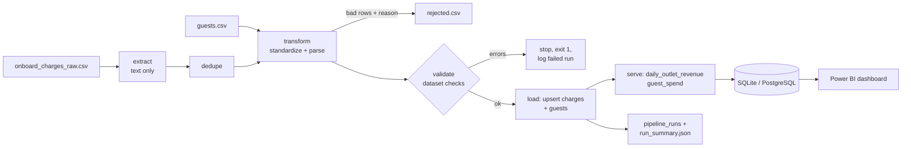

# Module 19: Capstone – Onboard Spend Pipeline

**Time:** 25–40 hours over 3–5 weeks · **Prerequisite:** Modules 00–18

## Bakit ko 'to kailangan?

This is the project you'll show in interviews, link on your portfolio site, and talk through for 20 minutes when someone says *"Tell me about a pipeline you built."* Certificates show you studied; this shows you can build. It's also built on a domain you understand better than most candidates: hospitality operations, guest charges and folios. Use that.

**Data is synthetic.** Never use real guest, client or employer data in a portfolio project.

---

## The brief (write it like a requirement, because you're a BA)

> Resort-at-sea outlets (Bar, Restaurant, Spa, Boutique, Excursions, Cafe) post guest charges to a daily CSV. The file is messy: inconsistent outlet names, three date formats, blank amounts, double-posted rows, and occasional charges for guests who don't exist in the guest master. Finance needs a trusted daily view of revenue by outlet and spend by guest. The process must be automatic, safe to re-run, and must never lose a charge silently.

### Functional requirements

| ID | Requirement |
|---|---|
| FR-1 | Run from the command line: `python -m onboard_pipeline --raw <csv> --guests <csv> --db <sqlite path> --out-dir <folder>` |
| FR-2 | Read the raw file as text and keep an untouched copy (raw layer) |
| FR-3 | Remove exact duplicate rows and count them |
| FR-4 | Standardize outlet names; parse all three date formats explicitly; convert amounts |
| FR-5 | Quarantine rows with an invalid amount, invalid date or unknown guest_id to `<out-dir>/rejected.csv` with a `reason` column. Nothing is dropped silently |
| FR-6 | Stop the load (exit code ≠ 0) on dataset-level errors: duplicate charge_id, sale ≤ 0, refund ≥ 0, no rows |
| FR-7 | Load `charges` with an upsert on charge_id (idempotent) |
| FR-8 | Load the guest master into `guests` |
| FR-9 | Build serve tables: `daily_outlet_revenue` (charge_date, outlet, total, charges) and `guest_spend` (guest_id, loyalty_tier, total_spend, n_charges, rank: dense, 1 = highest) |
| FR-10 | Log every run in `pipeline_runs` (run_id, started_at, extracted, duplicates_removed, rejected, loaded, status) and write `<out-dir>/run_summary.json` |
| FR-11 | Reconciliation: extracted = duplicates_removed + rejected + loaded |

### Non-functional requirements

| ID | Requirement |
|---|---|
| NFR-1 | Re-running with the same input changes no row counts (except one new `pipeline_runs` row) |
| NFR-2 | At least 10 unit tests in `tests/`, run by GitHub Actions on every push |
| NFR-3 | Runs in Docker (`Dockerfile` in the repo) |
| NFR-4 | README with architecture diagram, how to run, data quality rules and design decisions |
| NFR-5 | Logging (not print) with a summary line per run |
| NFR-6 | No secrets or real data committed |

### Definition of done

```bash
python check.py 19
```

runs `test_acceptance.py` against your project in `modules/19_capstone/project/`. All 10 acceptance tests must pass. When you move the project to its own GitHub repo, point the tests at it:

```bash
# Windows PowerShell
$env:CAPSTONE_PROJECT = "C:\path\to\onboard-spend-pipeline"; python check.py 19
# Mac / Linux
CAPSTONE_PROJECT=/path/to/onboard-spend-pipeline python check.py 19
```

---

## Architecture



## Project layout (already scaffolded in `project/`)

```
project/
├── README.md                  # fill in every section
├── requirements.txt
├── Dockerfile                 # TODO
├── .github/workflows/tests.yml
├── src/onboard_pipeline/
│   ├── __init__.py
│   ├── __main__.py            # CLI (done for you)
│   ├── config.py              # formats, outlet map, table names
│   ├── extract.py             # TODO
│   ├── transform.py           # TODO
│   ├── quality.py             # TODO
│   ├── load.py                # TODO
│   ├── serve.py               # TODO
│   └── pipeline.py            # TODO: orchestration, run log, summary
└── tests/
    ├── conftest.py
    └── test_transform.py      # 1 example; write at least 10 tests total
```

Reuse your own code from Modules 13, 16 and 17. That's the point: you're assembling parts you already understand.

---

## Milestones

| Week | Milestone | Proof |
|---|---|---|
| 1 | extract + transform + quarantine working; 5 unit tests | `rejected.csv` explained row by row |
| 2 | quality checks, idempotent load, serve tables, run log | acceptance tests 4–9 pass |
| 3 | README, Dockerfile, GitHub Actions green | all 10 acceptance tests pass |
| 4 (stretch) | PostgreSQL via docker compose; Airflow or Kestra DAG; Power BI report on the serve tables | screenshots in README |

## Stretch goals (pick any, each is an interview story)

- **PostgreSQL + SQLAlchemy:** switch databases by changing only `DB_URL`.
- **Incremental mode:** `--incremental` with a watermark (Module 17).
- **Backfill by date:** `--date` to process one day's file; idempotent per date.
- **Airflow / Kestra DAG** wrapping the steps (Module 18).
- **Power BI dashboard** on `daily_outlet_revenue` and `guest_spend`. You already hold a Power BI certificate; this connects it to engineering.
- **dbt** for the serve layer instead of pandas (after your dbt Fundamentals course).
- **Data contract:** a YAML file describing the expected raw schema, validated at extract time.

## README template (what reviewers look for)

1. **One-paragraph summary**: the business problem, in plain words.
2. **Architecture**: the diagram above, adapted.
3. **How to run**: venv + `pip install -r requirements.txt` + the exact command; Docker command.
4. **Data quality**: table of every rule, what happens when it fails (quarantine / stop), and a sample of the run summary.
5. **Design decisions**: why text-first extract, why upsert, why quarantine instead of drop, why SQLite (and how to switch to PostgreSQL). Each decision in 2–3 sentences.
6. **What I'd do next**: shows you know the limits (incremental loads, orchestration, monitoring).

## How to present it in an interview (practise this)

Use the script from Module 17, then go one level deeper on whatever they ask. Have these numbers ready from your own run: rows extracted, duplicates, rejected by reason, loaded, run time. Concrete numbers make the story credible.
